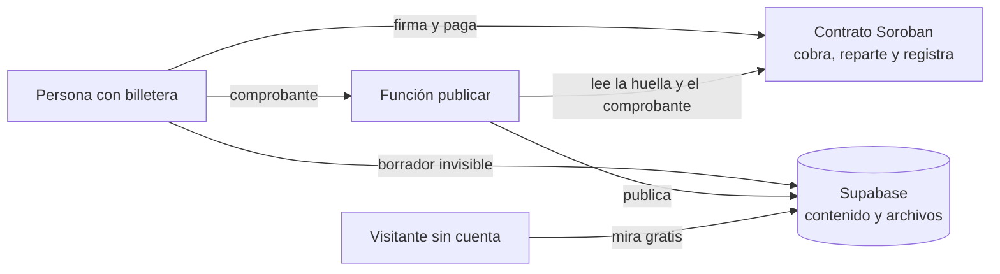

# UMBRAL

**Más allá de lo tangible.**

Un museo vivo en internet. Artistas y museos exponen una obra, la gente deja lo que esa obra le despertó, y otros lo continúan. Alrededor de cada obra crece una constelación de huellas. Cada huella se paga en Stellar y el 70% va al artista.

Proyecto para el Hackathon Sin Coordenada — FLAT 2026 (BAF × Stellar).

> **Prototipo en la red de pruebas de Stellar.** Los pagos y los repartos son reales en el contrato; el dinero es de prueba y las obras de la demo son de ejemplo.

| | |
|---|---|
| Demo en vivo | [umbralmuseo.vercel.app](https://umbralmuseo.vercel.app) |
| Contrato (red de pruebas) | [`CBPXN2SA…V3TP`](https://stellar.expert/explorer/testnet/contract/CBPXN2SA3RPEUXQIOSWVBSQQ2ENJCZWT2E4ZPUEG3SR34RMANEMFV3TP) |
| Transacciones verificadas | [docs/txs.md](docs/txs.md) |
| Fuente de la verdad | [SPEC.md](SPEC.md) |
| Guion de la demo | [docs/demo-jurado.md](docs/demo-jurado.md) |

---

## Eje

**Eje I · Arte**, con raíz en un territorio: Resistencia, Chaco. umbral ayuda a mostrar y financiar obra con pagos directos al artista, y guarda lo que cada obra despierta en la gente. Sin el arte no tiene sentido: no hay obra que continuar ni artista que cobre.

## El problema

Un artista sube su obra a una red social. Recibe algunos corazones y al otro día nadie la ve. No sabe qué provocó ni en quién, y casi nunca recibe dinero de quien la disfrutó. A un museo chico le pasa lo mismo: cuando la visita se va, no queda rastro de lo que sintió.

En una encuesta mundial a 5.039 músicos independientes (Ditto Music, 2026), solo el 22% vive de la música y el 86% tiene que producir contenido para redes para promocionarse.

## El primer caso: las esculturas de Resistencia

UMBRAL sirve para cualquier artista o museo. Para mostrarlo elegimos un caso que conocemos: Resistencia, Chaco, la ciudad de las esculturas.

- Hay más de 650 esculturas en la calle ([Bienal del Chaco, junio de 2026](https://bienaldelchaco.org/2026/en-el-dia-del-escultor-chaqueno-presentaron-museo-a-cielo-abierto-la-nueva-plataforma-digital-del-patrimonio-escultorico-de-resistencia/)).
- El escultor cobra una vez, cuando hace la obra. La obra vive décadas en la vereda y él no vuelve a recibir nada, ni se entera de qué provoca.
- Lo que los vecinos y visitantes sienten frente a cada escultura no queda en ningún lado.
- El catálogo ya existe: la Fundación Urunday tiene la plataforma Museo a Cielo Abierto, con fichas y mapa. UMBRAL no lo reemplaza: suma las voces de la gente y un pago que vuelve al escultor.

## Cómo funciona

1. Cualquiera entra y mira todo, gratis y sin cuenta.
2. Un artista conecta su billetera y **expone una obra**: título, descripción y una foto, un texto o un audio.
3. Otra persona la **continúa** con un texto corto. Esa huella queda unida a la obra con una línea.
4. Quien quiera **apoya** la obra con el monto que elija.
5. El artista **cobra** lo que juntó cuando quiere, sin pedir permiso.
6. Quien tiene cuenta guarda **favoritos**, gratis.

Así se ve en la red de pruebas, con una obra de prueba:

| | |
|---|---|
|  |  |
| **1. Exponer.** Antes de firmar, quien sube la obra declara de quién son los derechos. | **2. Continuar.** El aviso dice cuánto cuesta y que el 70% va a quien expuso la obra. |
|  |  |
| **3. La constelación.** La obra queda en el centro y cada huella sale de la que continúa. | **4. Estuve ahí.** Una sala invitó a la artista y pagó su obra con su fondo. El sello sale del comprobante en la red: no se puede inventar. |

## Modelo de negocio

UMBRAL no cobra suscripción ni vende publicidad. Vive de una parte de cada participación.

| Acción | Precio | Artista | UMBRAL | Sala |
|---|---|---|---|---|
| Mirar y guardar favoritos | Gratis | — | — | — |
| Exponer una obra | 2 USDC o 20 XLM | — | 100% | — |
| Continuar una obra o una respuesta | 1 USDC o 10 XLM | 70% | 30% | — |
| Apoyar | Libre | 70% | 30% | — |
| Continuar durante la muestra de una sala | 1 USDC o 10 XLM | de 30% a 70% | 30% | de 0% a 40%, según la muestra |

- **El público paga por ser parte y no cobra.** En toda la cadena de respuestas, cobra el artista que expuso la obra.
- **Muestras de salas y museos:** UMBRAL abre la muestra a pedido de la sala, por hasta 90 días. La parte de la sala sale de la del artista y se fija por muestra, según lo que aporta (difusión, lugar, público). El artista firma viendo el porcentaje; sin su firma, su obra no entra en la muestra. El contrato nunca lo deja por debajo del 30%.
- Los precios son una hipótesis de prueba, no un modelo validado.

## Por qué blockchain y por qué Stellar

Lo mismo se podría hacer con una base de datos común, salvo dos cosas:

1. **Las reglas del reparto son públicas.** En la misma transacción en que alguien paga, el contrato anota la parte del artista. El artista la retira cuando quiere.
2. **El registro lo puede comprobar cualquiera.** Qué cuenta dejó cada huella, de cuál nació y cuándo queda en un registro que nosotros no podemos reescribir.

| Pregunta | Respuesta |
|---|---|
| ¿Quién desconfía de quién? | El artista no tiene por qué confiar en que una plataforma le liquide lo que le corresponde. |
| ¿Qué dispara algo en la red? | Abrir, continuar o apoyar: una sola transacción firmada por quien paga. |
| ¿Quién cobra? | El artista, UMBRAL y, durante una muestra, la sala. Los porcentajes están en el contrato. |
| ¿Qué pasa si alguien miente? | No se puede continuar una huella inexistente o retirada, ni cobrar el saldo de otro, ni publicar sin pagar. |

Mover 1 USDC en Stellar cuesta una fracción de centavo y llega en segundos. Con comisiones altas, un pago de un dólar no tendría sentido.

**Lo que depende de nosotros, y lo decimos:** el administrador puede cambiar precios y porcentajes (solo hacia adelante y nunca dejando al artista con menos del 30%), puede moderar una huella, puede actualizar el código del contrato (en la red de pruebas, para corregir errores; antes de producción pasa a varias firmas con aviso previo, o se quita) y el contenido vive en nuestra base de datos. A la red va un código del contenido: prueba que no fue alterado, pero no lo conserva.

## Arquitectura



1. La app arma el documento de la huella y calcula su código (SHA-256 de todo el contenido, fotos y audios incluidos).
2. Guarda un borrador invisible en la base y pide la firma. El contrato cobra, reparte y registra el código.
3. La función `publicar` comprueba en la red que esa huella existe, que el comprobante es suyo y que el contenido da el mismo código. Recién ahí la publica.

El navegador no puede publicar, cambiar ni borrar nada. Detalle en [docs/arquitectura.md](docs/arquitectura.md). Funciones, permisos, almacenamiento y eventos del contrato en [docs/contrato.md](docs/contrato.md).

## Evidencia en la red de pruebas

Desplegado el 27/11/2026. Las 19 transacciones y la comprobación de saldos están en [docs/txs.md](docs/txs.md).

| Qué | Comprobante |
|---|---|
| Exponer una obra (2 USDC a UMBRAL) | [a5837533…](https://stellar.expert/explorer/testnet/tx/a58375336fb73c41f72e904125aaeacf9e408eb38e82e3bfee3512a0c3b11d43) |
| Continuar una obra (0,70 artista; 0,30 UMBRAL) | [faae8bd6…](https://stellar.expert/explorer/testnet/tx/faae8bd6772af654545ee66a596b9103154bb6e3e0cdb810f58865885110df47) |
| Apoyar | [f706696f…](https://stellar.expert/explorer/testnet/tx/f706696f07603ad710cfa971c4bfdd5db448e6c52f571b130bd22c2f65cceba5) |
| Continuar pagando en XLM | [ab312b0c…](https://stellar.expert/explorer/testnet/tx/ab312b0c0605682d0ce42b37ff75e365311311ce05cd02fd89009933ba42247c) |
| La artista cobra 2,10 USDC | [2569212d…](https://stellar.expert/explorer/testnet/tx/2569212d4047f4debfa49cdd8b5a596ee470c35861b8dfb1d84e7ae0ae8e1197) |
| Obra invitada, pagada por el fondo de una sala | [1ea298c9…](https://stellar.expert/explorer/testnet/tx/1ea298c93897431fbf3087c7966c035b66b05685b6a2d1144b47abd376ae04e4) |
| Continuar durante una muestra (0,50 artista; 0,20 sala; 0,30 UMBRAL) | [23500231…](https://stellar.expert/explorer/testnet/tx/23500231d9134deff73292741f6623859b910c84c44a489b25b30c5cdd43b9a2) |
| El museo retira lo que no se usó del fondo | [0c2cc774…](https://stellar.expert/explorer/testnet/tx/0c2cc7747443d5a9b45e20008a6545ef52992f820eef7afbf17b768a8850b5f5) |

## Validación con personas de afuera

Las pruebas con personas de afuera del equipo se hacen el sábado 28/11 con la [guía de pruebas](docs/guia-pruebas.md).

| Quién (rol) | Qué hizo | Qué dijo | Qué cambiamos |
|---|---|---|---|
| *(se completa con las pruebas)* | | | |

## Calidad

| Qué | Cómo |
|---|---|
| Contrato | 55 pruebas automáticas: repartos, piso del artista, muestras, firmas, montos absurdos, precios que suben, unidades que no se pierden. |
| Base de datos | 30 pruebas de las reglas de acceso: el navegador no publica sin pago, no cambia ni borra, no ve borradores ajenos, no sube archivos fuera de lugar. |
| Servidor | Publicar sin pago, con un comprobante ajeno o repetido: rechazado. Favoritos con firma ajena o vencida: rechazado. |
| Almacenamiento en la red | Solo un código de 32 bytes por huella; los artistas acumulan saldo y lo retiran juntos. La vigencia se renueva en cada acción y cualquiera puede renovarla. |

## Qué usamos de Stellar

| Componente | Para qué |
|---|---|
| Contrato en Soroban (soroban-sdk 30) | Registra huellas, cobra y reparte |
| USDC y XLM (contratos de activo de Stellar) | Los pagos |
| Stellar Wallets Kit | La persona elige su billetera |
| Firma de mensajes (SEP-53) | Entrar a favoritos sin pagar ni crear contraseñas |
| SDK de JavaScript y Stellar CLI | Cliente generado desde el contrato compilado |
| Stellar Expert | Comprobante público de cada acción |

## Cómo correrlo

```bash
# Contrato
cd contrato && cargo test

# App
cd app && npm install && npm run dev
```

La base se crea con [supabase/esquema.sql](supabase/esquema.sql) y las funciones del servidor están en [supabase/functions/](supabase/functions/).

## Estructura

```
SPEC.md       Fuente de la verdad: qué es, qué se decidió y qué es real hoy
contrato/     Contrato Soroban y sus pruebas
app/          App web (React + Vite + TypeScript)
supabase/     Esquema de la base y funciones del servidor
web/          Portada y maqueta navegable
docs/         Arquitectura, transacciones, cuidado de las personas e identidad
```

## Cuidado de las personas

Detalle en [docs/cuidado.md](docs/cuidado.md), [términos de uso](docs/terminos.md) y [política de privacidad](docs/privacidad.md).

- Aviso de no contar datos sensibles antes de publicar.
- Retirar una huella borra su contenido de la base. El comprobante en la red no se puede borrar, y lo avisamos antes.
- Filtro de palabras para las respuestas del público, contra el racismo y la violencia contra personas. No censura el arte ni la expresión. La lista está armada y se activa antes de abrir umbral al público.
- Quien expone una obra declara que es suya, que es de dominio público o que tiene autorización de su autor.
- Solo mayores de 18 en esta versión.

## Real y simulado

| Real | De prueba o de ejemplo |
|---|---|
| Contrato desplegado, con sus repartos, pisos y muestras | El dinero: USDC y XLM de la red de pruebas |
| Base de datos, reglas de acceso y funciones del servidor | Las obras, artistas y salas de la demo |
| Cada pago y cada cobro, con su comprobante en Stellar Expert | El museo que abre una muestra |
| Ingreso con billetera y firma de mensajes | |

## Límites de esta versión

- Funciona en la red de pruebas: el dinero no es real.
- El contenido vive en nuestra base de datos, así que su permanencia depende de nosotros.
- El modelo con museos todavía no está validado con un museo real.

## Camino a producción

- Entrar con correo: UMBRAL guía a quien nunca usó cripto a crear su billetera de Stellar. Suma usuarios nuevos a la red.
- Panel para museos con los números de su muestra.
- Un museo piloto, empezando por las esculturas de Resistencia.
- Pasar a la red principal de Stellar con USDC real, después de una revisión externa del contrato.

## Equipo

- **Facundo Ayala** — contrato y desarrollo.
- **Lucía Paz** — identidad, experiencia y pantallas.

## Derechos

© 2026 equipo UMBRAL. Todos los derechos reservados. El código se publica para revisión y evaluación; no se permite usarlo sin autorización. Ver [LICENSE](LICENSE).
