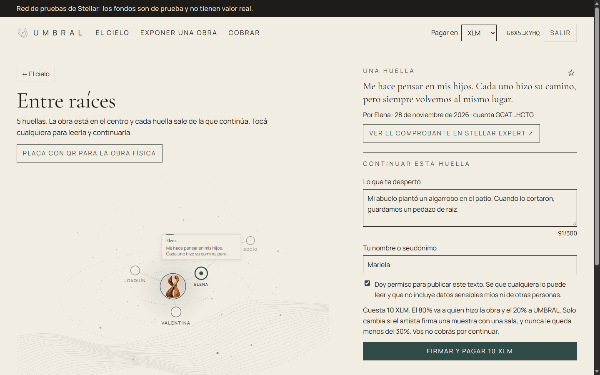
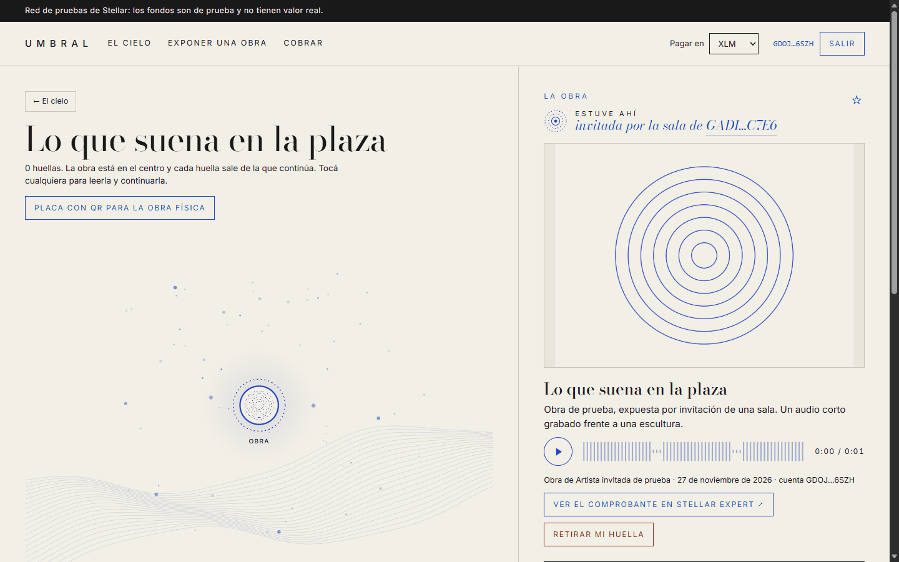
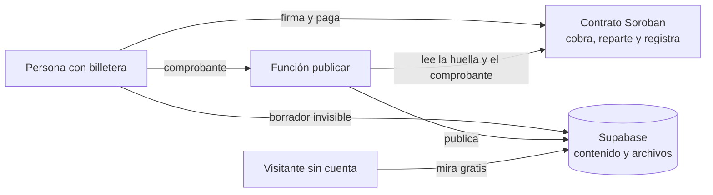

# UMBRAL

**Más allá de lo tangible.**

Un museo vivo en internet. Artistas y museos exponen una obra, la gente deja lo que esa obra le despertó, y otros lo continúan. Alrededor de cada obra crece una constelación de huellas. Cada huella se paga en Stellar y el 70% va al artista.

Proyecto para el Hackathon Sin Coordenada — FLAT 2026 (BAF × Stellar).

> **Prototipo en la red de pruebas de Stellar.** Los pagos y los repartos son reales en el contrato; el dinero es de prueba y las obras de la demo son de ejemplo.

| | |
|---|---|
| Demo en vivo | [umbralmuseo.vercel.app](https://umbralmuseo.vercel.app) |
| Contrato (red de pruebas) | [`CBPXN2SA…V3TP`](https://stellar.expert/explorer/testnet/contract/CBPXN2SA3RPEUXQIOSWVBSQQ2ENJCZWT2E4ZPUEG3SR34RMANEMFV3TP) |
| Transacciones verificadas | [docs/txs.md](docs/txs.md) |
| Guion de la demo | [docs/demo-jurado.md](docs/demo-jurado.md) |

---

## Eje

**Eje I · Arte**, con raíz en un territorio: Resistencia, Chaco. umbral ayuda a mostrar y financiar obra con pagos directos al artista, y guarda lo que cada obra despierta en la gente. Sin el arte no tiene sentido: no hay obra que continuar ni artista que cobre.

## El problema

Un artista sube su obra a una red social. Recibe algunos corazones y al otro día nadie la ve. No sabe qué provocó ni en quién, y casi nunca recibe dinero de quien la disfrutó. A un museo chico le pasa lo mismo: cuando la visita se va, no queda rastro de lo que sintió.

En el autocenso de artistas visuales de Argentina (AVAA, 4.961 respuestas), al 58% no le alcanza lo que gana con su arte, solo el 33% vive del arte y casi el 70% tiene más de un trabajo ([Artishock, 2021](https://artishockrevista.com/2021/01/11/avaa-avances-y-proyectos-para-el-2021)). En la música pasa lo mismo: en una encuesta mundial a 5.039 músicos independientes (Ditto Music, 2026), solo el 22% vive de la música.

## El primer caso: las esculturas de Resistencia

UMBRAL sirve para cualquier artista o museo. Para mostrarlo elegimos un caso que conocemos: Resistencia, Chaco, la ciudad de las esculturas.

- Hay más de 650 esculturas en la calle ([Bienal del Chaco, junio de 2026](https://bienaldelchaco.org/2026/en-el-dia-del-escultor-chaqueno-presentaron-museo-a-cielo-abierto-la-nueva-plataforma-digital-del-patrimonio-escultorico-de-resistencia/)).
- El escultor cobra una vez, cuando hace la obra. La obra vive décadas en la vereda y él no vuelve a recibir nada, ni se entera de qué provoca.
- Lo que los vecinos y visitantes sienten frente a cada escultura no queda en ningún lado.
- El catálogo ya existe: la Fundación Urunday tiene la plataforma Museo a Cielo Abierto, con fichas y mapa. UMBRAL no lo reemplaza: suma las voces de la gente y un pago que vuelve al escultor.

La primera colección del museo es **Una ciudad que resuena · Colección 001**, curada por Lucía: seis obras de seis disciplinas (escultura, textil, memoria familiar, arte sonoro, objeto y cestería). A su lado hay memorias que suenan, como la lluvia en un techo de chapa o la pava de la mañana, y cartas. Una de las obras es la historia de Lucía: *La sopa paraguaya de Mirta*, la receta de su abuela, que llegó desde Paraguay a los diez años. Muestra que el valor de lo que se comparte no depende de tener una trayectoria.

## Cómo funciona

1. Cualquiera entra y mira todo, gratis y sin cuenta.
2. Un artista conecta su billetera y **expone una obra**: título, descripción y una foto, un texto o un audio.
3. Otra persona la **continúa** con un texto corto. Esa huella queda unida a la obra con una línea.
4. Quien quiera **apoya** la obra con el monto que elija.
5. El artista **cobra** lo que juntó cuando quiere, sin pedir permiso: va directo a su billetera.
6. Para la obra física, el artista imprime una **placa con QR firmada**. Quien tiene la obra enfrente escanea y deja su huella ahí mismo.
7. Quien tiene cuenta guarda **favoritos**, gratis.

Así se ve en la red de pruebas, con una obra de prueba:

| | |
|---|---|
|  |  |
| **1. Exponer.** Antes de firmar, quien sube la obra elige de quién son los derechos y ve cómo va a quedar y cuánto cuesta. | **2. Continuar.** Antes de firmar dice cuánto cuesta y que el 70% va a quien hizo la obra. Quien continúa no cobra. |
|  |  |
| **3. La constelación.** Gira en 3D: la obra queda en el centro y cada huella sale de la que continúa. Al tocar una, se lee su texto. | **4. Estuve ahí.** Una sala invitó a la artista y pagó su obra con su fondo. El sello sale del comprobante en la red: no se puede inventar. |

## Qué nos diferencia

UMBRAL no es un marketplace ni un museo virtual para mirar. **No vende obras: vende participación.** Una huella no se compra para revenderla: no hay especulación, solo gente que dice algo sobre una obra y un pago que vuelve a quien la hizo.

| | Marketplaces de arte y NFT | Museos virtuales | Propinas y membresías | UMBRAL |
|---|---|---|---|---|
| Qué se paga | La obra, una vez | Nada, o una entrada | Apoyo a la persona | Continuar una obra concreta |
| Sirve para arte que no se vende (escultura en la calle, mural) | No | Solo para mirarlo | No queda ligado a la obra | **Sí: es el caso central** |
| Qué recibe el artista | Una venta | Nada | Propinas | **70% de cada huella y cada apoyo, para siempre** |
| Qué queda de quien participa | Un dueño | Una visita | Un pago | **Su palabra, firmada y unida a la obra** |

1. **El arte de la calle empieza a cobrar.** Una escultura en una plaza no tiene comprador. Con la **placa con QR** pegada al lado, quien la tiene enfrente escanea, deja su huella desde el celular y el 70% va a quien la hizo.
2. **La placa no se puede falsificar.** La crea y la firma con su billetera quien expuso la obra. Al escanearla, UMBRAL comprueba la firma y muestra un código que tiene que coincidir con el de la placa. Si alguien pega una placa trucha, la ficha avisa que no está firmada. Y aunque copien el código, el contrato le paga siempre a la cuenta registrada de la obra.
3. **La obra muestra lo que despierta.** Cada huella sale de la que continúa y la obra se vuelve una constelación en 3D que se puede girar. El artista ve qué generó su obra, no un número de "me gusta".
4. **Presencia real.** La sala escanea en la puerta el código de quien está ahí: quien llega abre "Mi código para el encuentro" (un QR con su cuenta) y la sala, desde "Invitar en la puerta", lo escanea y firma la invitación. El fondo de la sala le paga la obra que deja y esa obra lleva el sello "Estuve ahí", comprobable en la red. Como la invitación se hace cara a cara, el sello no se consigue desde la casa.

## Modelo de negocio

UMBRAL no cobra suscripción ni vende publicidad. Vive de una parte de cada participación.

| Acción | Precio | Artista | UMBRAL | Sala |
|---|---|---|---|---|
| Mirar y guardar favoritos | Gratis | — | — | — |
| Exponer una obra | 2 USDC o 20 XLM | — | 100% | — |
| Continuar una obra o una respuesta | 1 USDC o 10 XLM | 70% | 30% | — |
| Apoyar | Libre | 70% | 30% | — |
| Continuar durante la muestra de una sala | 1 USDC o 10 XLM | de 30% a 70% | 30% | de 0% a 40%, según la muestra |

- **El público paga por ser parte y no cobra.** En toda la cadena de respuestas, cobra el artista que expuso la obra.
- **Muestras de salas y museos:** UMBRAL abre la muestra a pedido de la sala, por hasta 90 días. La parte de la sala sale de la del artista y se fija por muestra, según lo que aporta (difusión, lugar, público). El artista firma viendo el porcentaje; sin su firma, su obra no entra en la muestra. El contrato nunca lo deja por debajo del 30%.
- Los precios son una hipótesis de prueba, no un modelo validado.

**Una cuenta de ejemplo.** Una sala con 30 obras que juntan 300 continuaciones en un mes: sus artistas reciben 210 USDC y UMBRAL 90 USDC, más 60 USDC por exponer las 30 obras. Hoy los costos fijos son casi cero (base de datos y web en planes gratuitos, y cada operación en Stellar cuesta una fracción de centavo). El primer cliente a buscar es una sala o un museo de Resistencia: el público pone el volumen, la sala sostiene el proyecto.

**Riesgos que conocemos.**
- Pagar 1 USD por dejar unas palabras puede frenar a la gente. Es una hipótesis que todavía no validamos.
- Para participar hace falta una billetera de Stellar (el camino previsto es entrar con correo).
- Hoy una sola llave puede actualizar el contrato; en la red principal pasa a varias firmas.
- Hoy el administrador puede cambiar el porcentaje del artista para las huellas nuevas, sin bajarlo nunca del 30%. En la red principal ese cambio va a pedir varias firmas y un aviso previo.
- El contenido vive en nuestra base de datos.
- Para usar dinero real a escala falta resolver lo legal: botón de arrepentimiento, activos virtuales e impuestos.

## Por qué blockchain y por qué Stellar

Lo mismo se podría hacer con una base de datos común, salvo dos cosas:

1. **Las reglas del reparto son públicas.** En la misma transacción en que alguien paga, el contrato anota la parte del artista. El artista la retira cuando quiere.
2. **El registro lo puede comprobar cualquiera.** Qué cuenta dejó cada huella, de cuál nació y cuándo queda en un registro que nosotros no podemos reescribir.

| Pregunta | Respuesta |
|---|---|
| ¿Quién desconfía de quién? | El artista no tiene por qué confiar en que una plataforma le liquide lo que le corresponde. |
| ¿Qué dispara algo en la red? | Abrir, continuar o apoyar: una sola transacción firmada por quien paga. |
| ¿Quién cobra? | El artista, UMBRAL y, durante una muestra, la sala. Los porcentajes están en el contrato. |
| ¿Qué pasa si alguien miente? | No se puede continuar una huella inexistente o retirada, ni cobrar el saldo de otro, ni publicar sin pagar. |

Mover 1 USDC en Stellar cuesta una fracción de centavo y llega en segundos. Con comisiones altas, un pago de un dólar no tendría sentido.

**Lo que depende de nosotros, y lo decimos:** el administrador puede cambiar precios y porcentajes (solo hacia adelante y nunca dejando al artista con menos del 30%), puede moderar una huella, puede actualizar el código del contrato (en la red de pruebas, para corregir errores; antes de producción pasa a varias firmas con aviso previo, o se quita) y el contenido vive en nuestra base de datos. A la red va un código del contenido: prueba que no fue alterado, pero no lo conserva.

## Arquitectura



1. La app arma el documento de la huella y calcula su código (SHA-256 de todo el contenido, fotos y audios incluidos).
2. Guarda un borrador invisible en la base y pide la firma. El contrato cobra, reparte y registra el código.
3. La función `publicar` comprueba en la red que esa huella existe, que el comprobante es suyo y que el contenido da el mismo código. Recién ahí la publica.

El navegador no puede publicar, cambiar ni borrar nada. Detalle en [docs/arquitectura.md](docs/arquitectura.md). Funciones, permisos, almacenamiento y eventos del contrato en [docs/contrato.md](docs/contrato.md).

## Evidencia en la red de pruebas

Desplegado el 27/11/2026. Las 19 transacciones y la comprobación de saldos están en [docs/txs.md](docs/txs.md).

| Qué | Comprobante |
|---|---|
| Exponer una obra (2 USDC a UMBRAL) | [a5837533…](https://stellar.expert/explorer/testnet/tx/a58375336fb73c41f72e904125aaeacf9e408eb38e82e3bfee3512a0c3b11d43) |
| Continuar una obra (0,70 artista; 0,30 UMBRAL) | [faae8bd6…](https://stellar.expert/explorer/testnet/tx/faae8bd6772af654545ee66a596b9103154bb6e3e0cdb810f58865885110df47) |
| Apoyar | [f706696f…](https://stellar.expert/explorer/testnet/tx/f706696f07603ad710cfa971c4bfdd5db448e6c52f571b130bd22c2f65cceba5) |
| Continuar pagando en XLM | [ab312b0c…](https://stellar.expert/explorer/testnet/tx/ab312b0c0605682d0ce42b37ff75e365311311ce05cd02fd89009933ba42247c) |
| La artista cobra 2,10 USDC | [2569212d…](https://stellar.expert/explorer/testnet/tx/2569212d4047f4debfa49cdd8b5a596ee470c35861b8dfb1d84e7ae0ae8e1197) |
| Obra invitada, pagada por el fondo de una sala | [1ea298c9…](https://stellar.expert/explorer/testnet/tx/1ea298c93897431fbf3087c7966c035b66b05685b6a2d1144b47abd376ae04e4) |
| Continuar durante una muestra (0,50 artista; 0,20 sala; 0,30 UMBRAL) | [23500231…](https://stellar.expert/explorer/testnet/tx/23500231d9134deff73292741f6623859b910c84c44a489b25b30c5cdd43b9a2) |
| El museo retira lo que no se usó del fondo | [0c2cc774…](https://stellar.expert/explorer/testnet/tx/0c2cc7747443d5a9b45e20008a6545ef52992f820eef7afbf17b768a8850b5f5) |

## Validación con personas de afuera

Las pruebas con personas de afuera del equipo se hacen el sábado 28/11 con la [guía de pruebas](docs/guia-pruebas.md).

| Quién (rol) | Qué hizo | Qué dijo | Qué cambiamos |
|---|---|---|---|
| *(se completa con las pruebas)* | | | |

## Calidad

| Qué | Cómo |
|---|---|
| Contrato | 55 pruebas automáticas: repartos, piso del artista, muestras, firmas, montos absurdos, precios que suben, unidades que no se pierden. |
| Base de datos | 30 pruebas de las reglas de acceso: el navegador no publica sin pago, no cambia ni borra, no ve borradores ajenos, no sube archivos fuera de lugar. |
| App | 70 pruebas automáticas (firma de la placa, fotos que se achican antes de firmarse, avisos) y una prueba de punta a punta en la red de pruebas: exponer, continuar, apoyar y cobrar. Lighthouse en celular: accesibilidad, buenas prácticas y SEO 100. |
| Servidor | Publicar sin pago, con un comprobante ajeno o repetido: rechazado. Favoritos con firma ajena o vencida: rechazado. |
| Almacenamiento en la red | Solo un código de 32 bytes por huella; los artistas acumulan saldo y lo retiran juntos. La vigencia se renueva en cada acción y cualquiera puede renovarla. |

## Qué usamos de Stellar

| Componente | Para qué |
|---|---|
| Contrato en Soroban (soroban-sdk 30) | Registra huellas, cobra y reparte |
| USDC y XLM (contratos de activo de Stellar) | Los pagos |
| Stellar Wallets Kit | La persona elige su billetera |
| Firma de mensajes (SEP-53) | Entrar a favoritos sin pagar ni crear contraseñas, y firmar gratis la placa con QR de cada obra |
| SDK de JavaScript y Stellar CLI | Cliente generado desde el contrato compilado |
| Stellar Expert | Comprobante público de cada acción |

## Cómo correrlo

```bash
# Contrato
cd contrato && cargo test

# App
cd app && npm install && npm run dev
```

La base se crea con [supabase/esquema.sql](supabase/esquema.sql) y las funciones del servidor están en [supabase/functions/](supabase/functions/).

## Estructura

```
SPEC.md       Fuente de la verdad: qué es, qué se decidió y qué es real hoy
contrato/     Contrato Soroban y sus pruebas
app/          App web (React + Vite + TypeScript)
supabase/     Esquema de la base y funciones del servidor
web/          Portada y maqueta navegable
docs/         Arquitectura, transacciones, cuidado de las personas e identidad
```

## Cuidado de las personas

Detalle en los [términos de uso](docs/terminos.md) y la [política de privacidad](docs/privacidad.md).

- Aviso de no contar datos sensibles antes de publicar.
- Retirar una huella borra su contenido de la base. El comprobante en la red no se puede borrar, y lo avisamos antes.
- Filtro de palabras para las respuestas del público, contra el racismo y la violencia contra personas. No censura el arte ni la expresión. Ya está activo en la base, con una lista de 45 palabras.
- Quien expone una obra declara que es suya, que es de dominio público o que tiene autorización de su autor.
- Solo mayores de 18 en esta versión.

## Real y simulado

| Real | De prueba o de ejemplo |
|---|---|
| Contrato desplegado, con sus repartos, pisos y muestras | El dinero: USDC y XLM de la red de pruebas |
| Base de datos, reglas de acceso y funciones del servidor | Las obras, artistas y salas de la demo |
| Cada pago y cada cobro, con su comprobante en Stellar Expert | El museo que abre una muestra |
| Ingreso con billetera y firma de mensajes | |

## Límites de esta versión

- Funciona en la red de pruebas: el dinero no es real.
- El contenido vive en nuestra base de datos, así que su permanencia depende de nosotros.
- El modelo con museos todavía no está validado con un museo real.
- Los borradores (lo que se guarda antes de pagar) no exigen la firma de la cuenta: alguien podría crear 5 a nombre de otra y frenarla una hora. No se pierde dinero ni se publica nada falso, porque publicar exige el pago en la red. El arreglo previsto: contar el límite por origen o pedir una firma SEP-53 del borrador.

## Camino a producción

- Entrar con correo: UMBRAL guía a quien nunca usó cripto a crear su billetera de Stellar. Suma usuarios nuevos a la red.
- Panel para museos con los números de su muestra.
- Encuentros virtuales: un código que cambia cada pocos segundos, mostrado en vivo durante la charla o la recorrida por videollamada, para que el sello pruebe que la persona estuvo en vivo.
- Un museo piloto, empezando por las esculturas de Resistencia.
- Pasar a la red principal de Stellar con USDC real, después de una revisión externa del contrato.

## UMBRAL ABIERTO: del piloto a la Bienal

> La exposición es temporal. La experiencia puede continuar.

UMBRAL ABIERTO es el nombre de los encuentros del museo, también fuera de la pantalla: muestras temporales y colecciones hechas junto con museos, salas, artistas y comunidades. Cada obra física lleva su placa con QR; quien la escanea ve su constelación sin cuenta y puede dejar su huella. Cuando la muestra se desmonta, la colección y sus huellas siguen en el museo digital.

Es una hoja de ruta, no un acuerdo: no consultamos todavía a ninguna institución.

| Etapa | Objetivo |
|---|---|
| Hackathon | Mostrar la plataforma y la visión, con la Colección 001. |
| Piloto propio | Un UMBRAL ABIERTO chico, con personas reales y obras autorizadas. |
| Primera colaboración | Proponer una colección a un museo de Resistencia. Nos gustaría trabajar con el Museo de Medios de Comunicación y el Museo del Hombre Chaqueño, que conservan la autoridad sobre sus piezas. |
| Bienal | Pedir un espacio en una futura Bienal Internacional de Escultura del Chaco (la de 2026 fue en julio). |
| Otras ciudades | Repetirlo con la identidad de cada lugar. |

Con comunidades y saberes tradicionales, las decisiones se toman con quienes los portan: autoría, consentimiento y qué se publica se acuerdan antes.

## Equipo

- **Facundo Ayala** — contrato y desarrollo.
- **Lucía Paz** — dirección creativa: identidad, experiencia, pantallas y curaduría. El proceso está en su [bitácora de diseño](docs/diseno/bitacora-2026-11-27.md).

## Derechos

© 2026 equipo UMBRAL. Todos los derechos reservados. El código se publica para revisión y evaluación; no se permite usarlo sin autorización. Ver [LICENSE](LICENSE).
