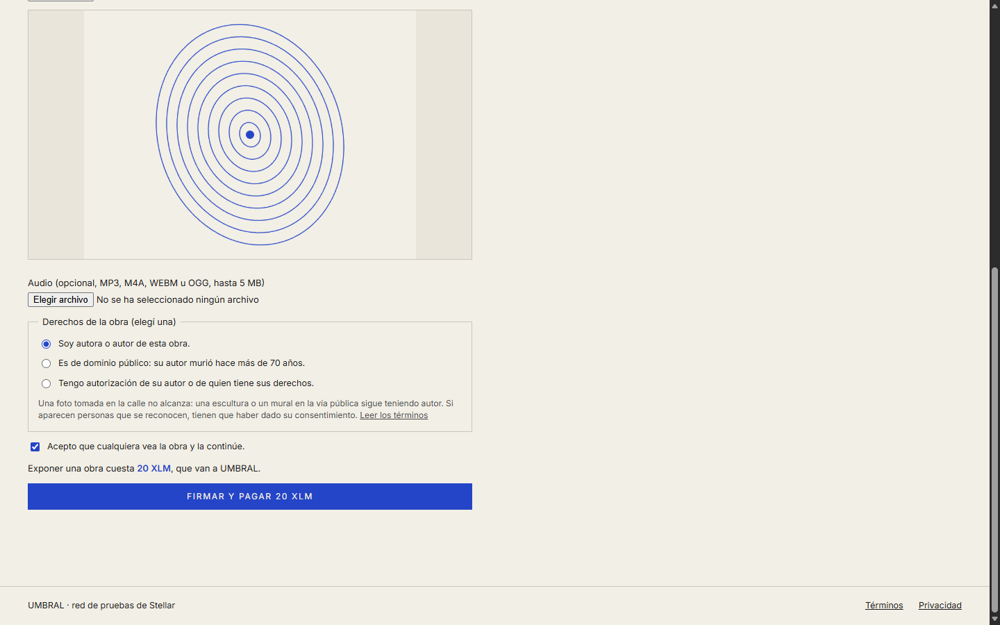
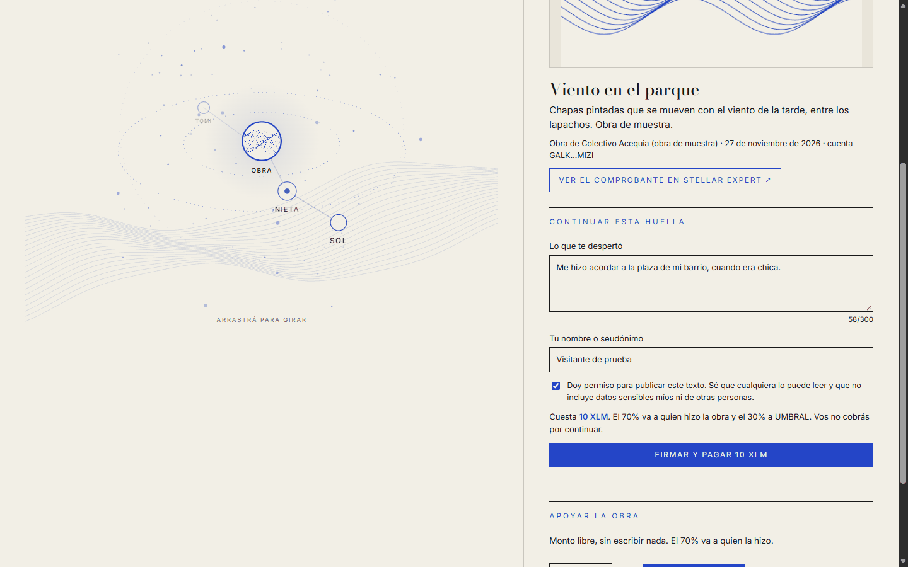
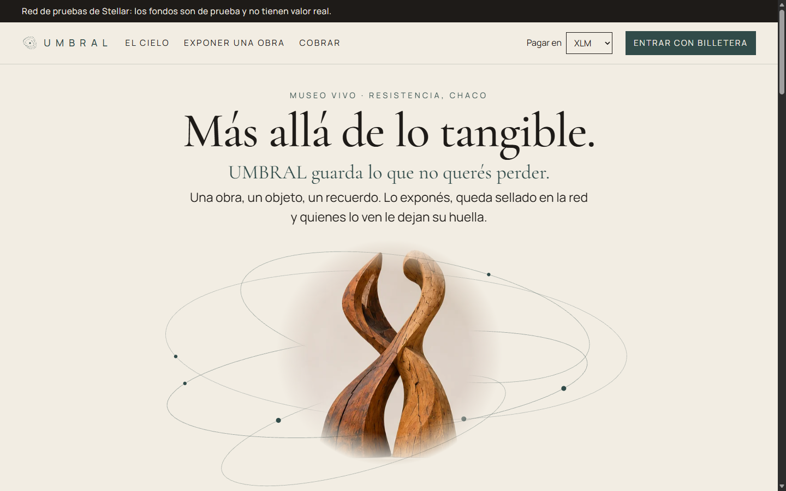
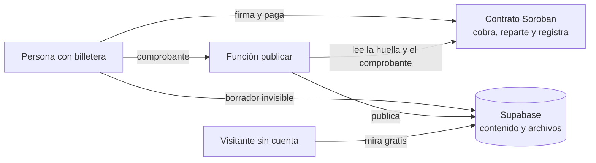

# UMBRAL

**Más allá de lo tangible.**

UMBRAL guarda lo que no querés perder. Una obra, un objeto, un recuerdo: lo exponés, queda sellado en la red y quienes lo ven le dejan su huella. Alrededor de cada obra crece una constelación. Es para artistas, salas y público, en museos, galerías y encuentros, en persona o virtuales.

Mirar es gratis. Cada huella se paga en Stellar: el 80% va a quien hizo la obra y el 20% sostiene UMBRAL.

Proyecto para el Hackathon Sin Coordenada — FLAT 2026 (BAF × Stellar).

> **Funciona hoy en la red de pruebas de Stellar.** Cada pago y cada reparto pasa de verdad por el contrato, con su comprobante público.

**UMBRAL en 4 líneas**

- **Problema real.** Al 58% de los artistas visuales de Argentina no le alcanza lo que gana con su arte ([AVAA](https://artishockrevista.com/2021/01/11/avaa-avances-y-proyectos-para-el-2021)). En Resistencia, Capital Nacional de las Esculturas por la [Ley 26.157](https://servicios.infoleg.gob.ar/infolegInternet/anexos/120000-124999/121593/norma.htm), hay más de 600 esculturas en la calle y sus autores cobraron una sola vez.
- **Arte, memoria y territorio.** La [Colección 001](#la-solución) junta seis obras de seis disciplinas, de la escultura a la receta de una abuela, y lo que la gente siente queda unido a cada obra.
- **Producto y validación.** La [web](https://umbralmuseo.vercel.app) funciona hoy, se mira gratis y sin cuenta, y la prueban personas de afuera del equipo ([validación](#validación-con-personas-de-afuera)).
- **Ejecución técnica.** Un contrato en Soroban cobra, reparte y registra en una sola transacción, con 99 pruebas del contrato, 136 de la app y [cada comprobante público](docs/txs.md).

**Probalo en 1 minuto**

1. Entrá a [umbralmuseo.vercel.app](https://umbralmuseo.vercel.app) y abrí una obra.
2. Escribí tu huella y tocá "Entrar con billetera".
3. Elegí Albedo, que se usa desde el navegador sin instalar nada. Si tu cuenta es nueva, la web te carga saldo de prueba gratis.
4. Firmá. Tu huella aparece en la constelación con su comprobante.

| | |
|---|---|
| Demo en vivo | [umbralmuseo.vercel.app](https://umbralmuseo.vercel.app) |
| Contrato (red de pruebas) | [`CBE4RP5R…J4ZM`](https://stellar.expert/explorer/testnet/contract/CBE4RP5RRN7HKZLQKYZKNZFVCGDOFB74JPWGGWSIAUNNLR3R3IUXJ4ZM) |
| Código del contrato verificado | [Verified, corrida pública](https://github.com/jfacundoayala/umbral/actions/runs/46139902038). Cualquiera puede repetirla |
| Transacciones verificadas | [docs/txs.md](docs/txs.md) |
| Guion de la demo | [docs/demo-jurado.md](docs/demo-jurado.md) |

---

## Eje

**Eje I · Arte**, cruzado con memoria y territorio. UMBRAL ayuda a mostrar obra y a que su autor cobre con pagos directos (arte), guarda recetas, fotos, sonidos y lo que cada obra le hizo sentir a la gente (memoria), y nace de un lugar concreto: Resistencia, Chaco (territorio). Sin la obra y sin quien la hizo no queda nada: no hay qué continuar ni quién cobre.

## El problema

Un artista sube su obra a una red social. Recibe algunos corazones y al otro día nadie la ve. No sabe qué provocó ni en quién, y casi nunca recibe dinero de quien la disfrutó. A un museo chico le pasa lo mismo: cuando la visita se va, no queda rastro de lo que sintió.

En el autocenso de artistas visuales de Argentina (AVAA, 4.961 respuestas), al 58% no le alcanza lo que gana con su arte, solo el 33% vive del arte y casi el 70% tiene más de un trabajo ([Artishock, 2021](https://artishockrevista.com/2021/01/11/avaa-avances-y-proyectos-para-el-2021)). En la música pasa lo mismo: en una encuesta mundial a 5.039 músicos independientes (Ditto Music, 2026), solo el 22% vive de la música.

## De dónde sale: las esculturas de Resistencia

El problema lo vimos en nuestra ciudad: Resistencia, Chaco, la ciudad de las esculturas. Es el contexto del que nace UMBRAL, no su único uso.

- Hay más de 600 esculturas en la calle ([Bienal del Chaco, junio de 2026](https://bienaldelchaco.org/2026/en-el-dia-del-escultor-chaqueno-presentaron-museo-a-cielo-abierto-la-nueva-plataforma-digital-del-patrimonio-escultorico-de-resistencia/)).
- El escultor cobra una vez, cuando hace la obra. La obra vive décadas en la vereda y él no vuelve a recibir nada, ni se entera de qué provoca.
- Lo que los vecinos y visitantes sienten frente a cada escultura no queda en ningún lado.
- El catálogo ya existe: la Fundación Urunday tiene la plataforma Museo a Cielo Abierto, con fichas y mapa. UMBRAL no lo reemplaza: suma las voces de la gente y un pago que vuelve al escultor.

## La solución

De ese problema nació algo más grande. **Un museo donde lo que no querés perder también es obra.** Una escultura, la receta de una abuela, la foto de una mascota que ya no está, el sonido de la lluvia en un techo de chapa. Lo subís y queda guardado en el museo. Quien lo ve le deja su huella, unas palabras con lo que sintió, y esa huella queda unida a la obra, a la vista de todos.

¿Por qué alguien pagaría por dejar unas palabras? Por lo mismo que algo se comparte miles de veces en una red social. Porque le gustó, porque se sintió identificado, por empatía. Acá ese gesto no se pierde al otro día y le llega a quien lo subió, que se queda con el 80% de cada huella.

La primera colección del museo es **Una ciudad que resuena · Colección 001**, curada por Lucía: seis obras de seis disciplinas (escultura, textil, memoria familiar, arte sonoro, objeto y cestería). A su lado hay memorias que suenan, como la lluvia en un techo de chapa o la pava de la mañana, y cartas. Una de las obras es la historia de Lucía: *La sopa paraguaya de Mirta*, la receta de su abuela, que llegó desde Paraguay a los diez años. Muestra que el valor de lo que se comparte no depende de tener una trayectoria.

## Cómo funciona

1. Cualquiera entra y mira todo, gratis y sin cuenta.
2. Un artista conecta su billetera y **expone una obra**: título, descripción y una foto, un texto o un audio.
3. Otra persona la **continúa** con un texto corto. Esa huella queda unida a la obra con una línea.
4. Quien quiera **apoya** la obra con el monto que elija.
5. El artista **cobra** lo que juntó cuando quiere, sin pedir permiso: va directo a su billetera.
6. Para la obra física, el artista imprime una **placa con QR firmada**. Quien tiene la obra enfrente escanea y deja su huella ahí mismo.
7. Quien tiene cuenta guarda **favoritos**, gratis.

Así se ve en la red de pruebas:

| | |
|---|---|
|  |  |
| **1. Exponer.** Antes de firmar, quien sube la obra elige de quién son los derechos y ve cómo va a quedar y cuánto cuesta. | **2. Continuar.** Antes de firmar dice cuánto cuesta y que el 80% va a quien hizo la obra. Quien continúa no cobra. |
|  |  |
| **3. La constelación.** Gira en 3D: la obra queda en el centro y cada huella sale de la que continúa. Al tocar una, se lee su texto. | **4. Estuve ahí.** Cuando una sala invita a alguien en la puerta y paga su obra con su fondo, la obra lleva este sello. Sale del comprobante en la red: no se puede inventar. |
|  | |
| **5. La portada.** Una sola obra al centro y su constelación: se entiende sin explicar qué es una blockchain. | |

## Qué nos diferencia

UMBRAL no es un marketplace ni un museo virtual para mirar. **No vende obras: vende participación.** Una huella no se compra para revenderla: no hay especulación, solo gente que dice algo sobre una obra y un pago que vuelve a quien la hizo.

| | Marketplaces de arte y NFT | Museos virtuales | Propinas y membresías | UMBRAL |
|---|---|---|---|---|
| Qué se paga | La obra, una vez | Nada, o una entrada | Apoyo a la persona | Continuar una obra concreta |
| Sirve para arte que no se vende (escultura en la calle, mural) | No | Solo para mirarlo | No queda ligado a la obra | **Sí: es el caso central** |
| Qué recibe el artista | Una venta | Nada | Propinas | **80% de cada huella y cada apoyo, al momento** (menos solo si acepta una muestra, nunca bajo 30%) |
| Qué queda de quien participa | Un dueño | Una visita | Un pago | **Su palabra, firmada y unida a la obra** |

1. **El arte de la calle empieza a cobrar.** Una escultura en una plaza no tiene comprador. Con la **placa con QR** pegada al lado, quien la tiene enfrente escanea, deja su huella desde el celular y el 80% va a quien la hizo.
2. **La placa no se puede falsificar.** La crea y la firma con su billetera quien expuso la obra. Al escanearla, UMBRAL comprueba la firma y muestra un código que tiene que coincidir con el de la placa. Si alguien pega una placa trucha, la ficha avisa que no está firmada. Y aunque copien el código, el contrato le paga siempre a la cuenta registrada de la obra.
3. **La obra muestra lo que hace sentir.** Cada huella sale de la que continúa y la obra se vuelve una constelación en 3D que se puede girar. El artista ve qué generó su obra, no un número de "me gusta".
4. **Presencia real.** La sala escanea en la puerta el código de quien está ahí: quien llega abre "Mi código para el encuentro" (un QR con su cuenta) y la sala, desde "Invitar en la puerta", lo escanea y firma la invitación. El fondo de la sala le paga la obra que deja y esa obra lleva el sello "Estuve ahí", comprobable en la red. Como la invitación se hace cara a cara, el sello no se consigue desde la casa.
5. **Cuentas claras.** La página "Cuentas claras" y cada ficha muestran el reparto leído en vivo del contrato, no escrito a mano: qué % va a quien hizo la obra, cuánto queda para UMBRAL, los precios, los enlaces al contrato y a la cuenta de UMBRAL, y lo que todavía puede cambiar. Lo contamos antes de que alguien lo encuentre en el código.
6. **Una pieza al centro.** La portada abre con una sola obra, "Entre raíces", y su constelación: se entiende sin explicar qué es una blockchain.

## Modelo de negocio

UMBRAL no cobra suscripción ni vende publicidad. Vive de una parte de cada participación.

| Acción | Precio | Artista | UMBRAL | Sala |
|---|---|---|---|---|
| Mirar y guardar favoritos | Gratis | — | — | — |
| Exponer una obra | 2 USDC | — | 100% | — |
| Continuar una obra o una respuesta | 1 USDC | 80% | 20% | — |
| Apoyar | Libre | 80% | 20% | — |
| Continuar durante la muestra de una sala | 1 USDC | de 30% a 70% | 30% | de 0% a 40%, según la muestra |

- **Los precios son en USDC.** Quien tiene XLM también puede pagar: hoy el contrato cobra un monto fijo en XLM (20 por exponer y 10 por continuar), que se ajusta a mano.
- **Quien recibe al público pone el fondo.** Como un museo que cubre la conservación de una pieza a cambio de exponerla, la sala o un padrino ponen el fondo de los encuentros: quien va en persona deja su obra sin pagar y se lleva el sello "Estuve ahí". El arte no paga por mostrarse; paga quien quiere estar cerca de él.
- **El público paga por ser parte y no cobra.** En toda la cadena de respuestas, cobra el artista que expuso la obra.
- **Muestras de salas y museos:** UMBRAL abre la muestra a pedido de la sala, por hasta 180 días. Durante la muestra UMBRAL se queda con el 30%, la sala con su parte, que se fija por muestra según lo que aporta (difusión, lugar, público), y el artista con el resto. El artista firma viendo el porcentaje; sin su firma, su obra no entra en la muestra. El contrato nunca lo deja por debajo del 30%. Si la sala no cobra nada (0%), el reparto sigue siendo 80% y 20%.

**Una cuenta de ejemplo.** Una sala con 30 obras que juntan 300 continuaciones en un mes: sus artistas reciben 240 USDC y UMBRAL 60 USDC, más 60 USDC por exponer las 30 obras. Hoy los costos fijos son casi cero (base de datos y web en planes gratuitos, y cada acción paga a la red unos centavos, 2 a 3 en la red de pruebas, aparte del precio; los paga quien firma). El primer cliente a buscar es una sala o un museo de Resistencia: el público pone el volumen, la sala sostiene el proyecto.

## Por qué blockchain y por qué Stellar

Lo mismo se podría hacer con una base de datos común, salvo dos cosas:

1. **Las reglas del reparto son públicas.** En la misma transacción en que alguien paga, el contrato anota la parte del artista. El artista la retira cuando quiere.
2. **El registro lo puede comprobar cualquiera.** Qué cuenta dejó cada huella, de cuál nació y cuándo queda en un registro que nosotros no podemos reescribir.

| Pregunta | Respuesta |
|---|---|
| ¿Quién desconfía de quién? | El artista no tiene por qué confiar en que una plataforma le liquide lo que le corresponde. |
| ¿Qué dispara algo en la red? | Abrir, continuar o apoyar: una sola transacción firmada por quien paga. |
| ¿Quién cobra? | El artista, UMBRAL y, durante una muestra, la sala. Los porcentajes están en el contrato. |
| ¿Qué pasa si alguien miente? | No se puede continuar una huella inexistente o retirada, ni cobrar el saldo de otro, ni publicar sin pagar. |

En Stellar cada acción paga a la red unos centavos (2 a 3 en la red de pruebas, aparte del precio) y llega en segundos. Con comisiones altas, un pago de un dólar no tendría sentido.

**Lo que depende de nosotros, y lo decimos:** el administrador puede cambiar precios y porcentajes (solo hacia adelante y nunca dejando al artista con menos del 30%), puede moderar una huella, puede actualizar el código del contrato (en dos pasos: lo propone, queda publicado y recién puede aplicarlo 1 día después; antes de producción pasa a varias firmas, o se quita) y el contenido vive en nuestra base de datos. A la red va un código del contenido: prueba que no fue alterado, pero no lo conserva.

## Arquitectura



1. La app arma el documento de la huella y calcula su código (SHA-256 de todo el contenido, fotos y audios incluidos).
2. Guarda un borrador invisible en la base y pide la firma. El contrato cobra, reparte y registra el código.
3. La función `publicar` comprueba en la red que esa huella existe, que el comprobante es suyo y que el contenido da el mismo código. Recién ahí la publica.

El navegador no puede publicar, cambiar ni borrar nada. Detalle en [docs/arquitectura.md](docs/arquitectura.md). Funciones, permisos, almacenamiento y eventos del contrato en [docs/contrato.md](docs/contrato.md).

## Evidencia en la red de pruebas

**Contrato final, 28/11/2026.** Toda la colección que se ve en la web está en el contrato final, cada obra y cada huella con su pago. Algunos ejemplos.

| Qué | Comprobante |
|---|---|
| Exponer "Entre raíces" | [9ccd61bd…](https://stellar.expert/explorer/testnet/tx/9ccd61bdfb2ca965202c59fe25570890a5e815f4a0f53abd0011a4d6925408bd) |
| Dejar una huella sobre "Entre raíces" (80% a quien la hizo) | [3d5f7440…](https://stellar.expert/explorer/testnet/tx/3d5f74409bef45528dc5a40618fafbc708537e4f77a93187460414b3cbe8e141) |
| Exponer "La sopa paraguaya de Mirta" | [dec14e22…](https://stellar.expert/explorer/testnet/tx/dec14e22f5892a078e569e91bc490d453ce087f07ea6508bdea6adcfd755353c) |
| Una sala abre su fondo e invita | [d9856b0d…](https://stellar.expert/explorer/testnet/tx/d9856b0d51ed840e6a799c5d830a2977820f9b6d1a08eff634d57e63ecdde86d) |
| Obra invitada por la sala, con el sello "Estuve ahí" | [8eaeda71…](https://stellar.expert/explorer/testnet/tx/8eaeda7130d705391cc0fa7241ae81b427231446d4dae947951a85f5e218a1f8) |

Antes, el 27/11, el mismo recorrido completo en el segundo contrato, con cobro del artista y retiro del fondo. Las 19 transacciones y la comprobación de saldos están en [docs/txs.md](docs/txs.md).

| Qué | Comprobante |
|---|---|
| Exponer una obra (2 USDC a UMBRAL) | [a5837533…](https://stellar.expert/explorer/testnet/tx/a58375336fb73c41f72e904125aaeacf9e408eb38e82e3bfee3512a0c3b11d43) |
| Continuar una obra (0,70 artista; 0,30 UMBRAL) | [faae8bd6…](https://stellar.expert/explorer/testnet/tx/faae8bd6772af654545ee66a596b9103154bb6e3e0cdb810f58865885110df47) |
| Apoyar | [f706696f…](https://stellar.expert/explorer/testnet/tx/f706696f07603ad710cfa971c4bfdd5db448e6c52f571b130bd22c2f65cceba5) |
| Continuar pagando en XLM | [ab312b0c…](https://stellar.expert/explorer/testnet/tx/ab312b0c0605682d0ce42b37ff75e365311311ce05cd02fd89009933ba42247c) |
| La artista cobra 2,10 USDC | [2569212d…](https://stellar.expert/explorer/testnet/tx/2569212d4047f4debfa49cdd8b5a596ee470c35861b8dfb1d84e7ae0ae8e1197) |
| Obra invitada, pagada por el fondo de una sala | [1ea298c9…](https://stellar.expert/explorer/testnet/tx/1ea298c93897431fbf3087c7966c035b66b05685b6a2d1144b47abd376ae04e4) |
| Continuar durante una muestra (0,50 artista; 0,20 sala; 0,30 UMBRAL) | [23500231…](https://stellar.expert/explorer/testnet/tx/23500231d9134deff73292741f6623859b910c84c44a489b25b30c5cdd43b9a2) |
| El museo retira lo que no se usó del fondo | [0c2cc774…](https://stellar.expert/explorer/testnet/tx/0c2cc7747443d5a9b45e20008a6545ef52992f820eef7afbf17b768a8850b5f5) |

## Validación con personas de afuera

Cinco personas de afuera del equipo prueban la web solas, sin explicación, con la [guía de pruebas](docs/guia-pruebas.md).

| # | Quién (rol) | Qué logró | Dónde se trabó | Qué dijo, textual | Qué cambiamos |
|---|---|---|---|---|---|
| 1 | | | | | |
| 2 | | | | | |
| 3 | | | | | |
| 4 | | | | | |
| 5 | | | | | |

## Calidad

| Qué | Cómo |
|---|---|
| Contrato | 99 pruebas automáticas: repartos, piso del artista, muestras, firmas, montos absurdos, precios que suben, unidades que no se pierden. |
| Base de datos | 30 pruebas de las reglas de acceso: el navegador no publica sin pago, no cambia ni borra, no ve borradores ajenos, no sube archivos fuera de lugar. |
| App | 136 pruebas automáticas (firma de la placa, qué obras llevan placa, fotos que se achican antes de firmarse, avisos), 17 recorridos en el navegador en celular y escritorio, y una prueba de punta a punta en la red de pruebas: exponer, continuar, apoyar y cobrar. Los recorridos se corren con `cd app && npm run e2e:web` (Playwright). |
| Web publicada | Lighthouse 12 el 28/11, antes de los arreglos (rendimiento / accesibilidad / buenas prácticas / SEO), en celular: portada 98/96/100/100, cielo 90/100/100/100, ficha 90/100/100/100, cuentas 93/100/100/100. En escritorio, rendimiento de 97 a 99. Después de los arreglos, axe-core da 0 problemas en 7 pantallas, en celular y en escritorio (la portada bajaba a 96 por el contraste de un botón, ya corregido). El detalle y lo que se arregló después están en la [auditoría web](docs/auditorias/2026-11-28-web.md). |
| Servidor | Publicar sin pago, con un comprobante ajeno o repetido: rechazado. Favoritos con firma ajena o vencida: rechazado. |
| Almacenamiento en la red | Solo un código de 32 bytes por huella; los artistas acumulan saldo y lo retiran juntos. La vigencia se renueva en cada acción y cualquiera puede renovarla. |

## Qué usamos de Stellar

| Componente | Para qué |
|---|---|
| Contrato en Soroban (soroban-sdk 30) | Registra huellas, cobra y reparte |
| USDC y XLM (contratos de activo de Stellar) | Los pagos |
| Stellar Wallets Kit | La persona elige su billetera |
| Firma de mensajes (SEP-53) | Entrar a favoritos sin pagar ni crear contraseñas, y firmar gratis la placa con QR de cada obra |
| SDK de JavaScript y Stellar CLI | Cliente generado desde el contrato compilado |
| Stellar Expert | Comprobante público de cada acción |

## Cómo usamos Raven

Raven nos acompañó como equipo durante todo el hackathon:

- **Diseño del proyecto e integración con Stellar.** Lo consultamos para decidir cómo armar el proyecto y qué componentes de Stellar usar: el contrato en Soroban, los pagos en USDC y XLM y las billeteras.
- **Análisis de proyectos parecidos.** Buscamos proyectos similares dentro y fuera de la red Stellar y los analizamos con un FODA: fortalezas, debilidades, qué convenía replicar y qué evitar. Con eso medimos nuestra solución y definimos la diferencia: UMBRAL no vende obras, vende participación.
- **Curaduría.** Lo usamos para curar todas las obras de "Una ciudad que resuena · Colección 001".
- **Auditoría técnica.** Le consultamos mucho sobre el contrato, los permisos y el reparto, y nos guiamos por sus respuestas. También le pedimos una simulación de jurado con la rúbrica. De ahí salieron cambios concretos: esta sección, la verificación del contrato y la explicación del paso al contrato nuevo.

## Cómo correrlo

```bash
# Contrato
cd contrato && cargo test

# App
cd app && npm install && npm run dev
```

La base se crea con [supabase/esquema.sql](supabase/esquema.sql) y las funciones del servidor están en [supabase/functions/](supabase/functions/).

## Estructura

```
contrato/          Contrato Soroban y sus pruebas
app/               App web (React + Vite + TypeScript) y sus pruebas
supabase/          Esquema de la base y funciones del servidor
docs/              Especificación, arquitectura, transacciones, cuidado de las personas e identidad
  spec.md          Qué es, qué se decidió y qué funciona hoy
  diseno/          Bitácora de diseño, bocetos y la maqueta navegable
.github/workflows/ Pruebas automáticas en cada cambio (app y contrato)
```

## Cuidado de las personas

Detalle en los [términos de uso](docs/terminos.md) y la [política de privacidad](docs/privacidad.md).

- Aviso de no contar datos sensibles antes de publicar.
- Retirar una huella borra su contenido de la base. El comprobante en la red no se puede borrar, y lo avisamos antes.
- Filtro de palabras para las respuestas del público, contra el racismo y la violencia contra personas. No censura el arte ni la expresión. Ya está activo en la base, con una lista de 45 palabras.
- Quien expone una obra declara que es suya, que es de dominio público o que tiene autorización de su autor.
- Solo mayores de 18 en esta versión.

## Real y simulado

| Real | De prueba o de ejemplo |
|---|---|
| Contrato desplegado, con sus repartos, pisos y muestras | El dinero: USDC y XLM de la red de pruebas |
| Base de datos, reglas de acceso y funciones del servidor | Las obras, artistas y salas de la demo |
| Cada pago y cada cobro, con su comprobante en Stellar Expert | El museo que abre una muestra |
| Ingreso con billetera y firma de mensajes | |

## Camino a producción

- Entrar con correo: UMBRAL guía a quien nunca usó cripto a crear su billetera de Stellar. Suma usuarios nuevos a la red.
- Panel para museos con los números de su muestra.
- Encuentros presenciales con el sello "Estuve ahí". Una sala, una galería o una juntada invita, quien va en persona deja su huella gratis y su obra queda sellada. Ya funciona en el contrato y hay una obra con el sello en la colección. Falta llevarlo a salas reales.
- Encuentros virtuales: un código que cambia cada pocos segundos, mostrado en vivo durante la charla o la recorrida por videollamada, para que el sello pruebe que la persona estuvo en vivo.
- Un museo piloto, empezando por las esculturas de Resistencia.
- Pasar a la red principal de Stellar con USDC real, después de una revisión externa del contrato.

## UMBRAL ABIERTO: del piloto a la Bienal

> La exposición es temporal. La experiencia puede continuar.

UMBRAL ABIERTO es el nombre de los encuentros del museo, también fuera de la pantalla: muestras temporales y colecciones hechas junto con museos, salas, artistas y comunidades. Cada obra física lleva su placa con QR; quien la escanea ve su constelación sin cuenta y puede dejar su huella. Cuando la muestra se desmonta, la colección y sus huellas siguen en el museo digital.

Esta es la hoja de ruta: cada etapa abre la siguiente.

| Etapa | Objetivo |
|---|---|
| Hackathon | Mostrar la plataforma y la visión, con la Colección 001. |
| Piloto propio | Un UMBRAL ABIERTO chico, con personas reales y obras autorizadas. |
| Primera colaboración | Proponer una colección a un museo de Resistencia. Nos gustaría trabajar con el Museo de Medios de Comunicación y el Museo del Hombre Chaqueño, que conservan la autoridad sobre sus piezas. |
| Bienal | Pedir un espacio en una futura Bienal Internacional de Escultura del Chaco (la de 2026 fue en julio). |
| Otras ciudades | Repetirlo con la identidad de cada lugar. |

Con comunidades y saberes tradicionales, las decisiones se toman con quienes los portan: autoría, consentimiento y qué se publica se acuerdan antes.

## Equipo

Facundo Ayala y Lucía Paz. El proceso de diseño está en la [bitácora](docs/diseno/bitacora-2026-11-27.md).

## Derechos

© 2026 equipo UMBRAL. Todos los derechos reservados. El código se publica para revisión y evaluación; no se permite usarlo sin autorización. Ver [LICENSE](LICENSE).
